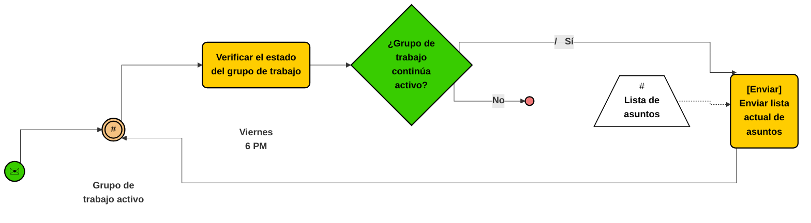
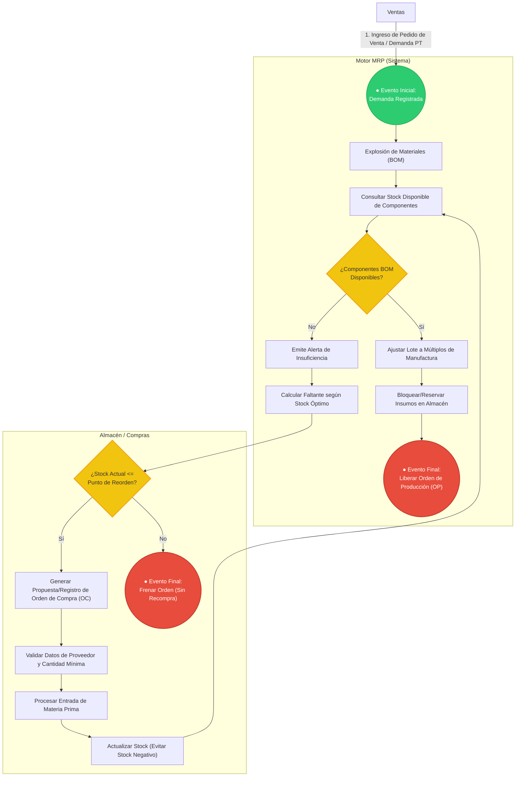

### Rafael Sánchez Saucedo
# Documento de Requerimientos - MRP (Trazabilidad, Caducidad y Merma)
**Módulo:** Gestión Avanzada de Órdenes de Compra (OC) y Órdenes de Producción (OP)

---

## 1. Definición de Requerimientos Funcionales

El módulo gestiona el ciclo operativo de aprovisionamiento y manufactura bajo esquemas de control por lotes, caducidad, merma técnica y costos indirectos de fabricación.

### Datos y Entidades Requeridas

* **Lote de Materia Prima / Componente:** ID Lote, ID Material, Cantidad Disponible, Cantidad Reservada, Fecha de Fabricación, Fecha de Caducidad, Ubicación en Almacén, Costo Unitario Real.
* **Lista de Materiales y Operaciones (BOM/Routing):** ID BOM, ID Producto Terminado, Componentes requeridos, Porcentaje de Scrap/Merma Nominal, Tiempo Estándar de Operación (minutos/horas máquina), Costo Indirecto Estimado.
* **Orden de Compra con Inspección (OC):** ID OC, ID Proveedor, Incoterm/Condición de Entrega, Líneas de Detalle (ID Material, Cantidad Solicitada, Cantidad Aceptada, Cantidad Rechazada, Precio Unitario, Lote Proveedor), Estado (`Emitida`, `En Aduana/Tránsito`, `Inspección de Calidad`, `Cerrada Conforme`, `Devuelta`).
* **Orden de Producción con Consumo Real (OP):** ID OP, ID Producto Terminado, Cantidad Programada, Cantidad Real Producida, Cantidad Desperdiciada (Scrap Real), Asignación de Lotes Consumidos (FIFO/FEFO), Centro de Trabajo, Estado (`Liberada`, `En Preparación`, `Paro de Línea`, `Finalizada con Desvío`, `Cerrada`).

---

## 2. Descripción de las Reglas de Negocio

* **Asignación de Materiales por FEFO (First Expired, First Out):** Al reservar componentes para una OP, el sistema debe asignar automáticamente aquellos lotes cuya fecha de caducidad sea más próxima, bloqueando lotes con vida útil menor al tiempo estimado de manufactura y distribución.
* **Ajuste por Merma Estándar:** Toda explosión de materiales para una OP debe calcular la materia prima bruta sumando el porcentaje de scrap inherente al proceso:
  $$\text{Cantidad Bruta} = \frac{\text{Cantidad Neta}}{1 - \% \text{Merma Nominal}}$$
* **Cuarentena e Inspección Previa al Stock Físico:** Las recepciones de OC no ingresan directamente a stock disponible; deben ingresar a un almacén lógico de `Inspección/Calidad`. Solo las partidas marcadas como "Aprobadas" se trasladan a inventario disponible; las unidades con defecto deben generar un folio de devolución o nota de crédito.
* **Tolerancia en Sobredelivery de Proveedores:** El sistema permite variaciones en la recepción física contra la OC de un máximo de $\pm 5\%$ en productos a granel/líquidos, recalculando la factura automáticamente sin permitir recepciones fuera de dicha tolerancia sin autorización gerencial.
* **Cierre de OP con Desvío:** Si la producción real difiere de la cantidad programada por variaciones de scrap, la OP solo puede cerrarse si el supervisor documenta la justificación del desvío cuando supere el umbral del $\pm 3\%$.

---

## 3. Integridad de los Datos

* **Trazabilidad Bidireccional Estricta:** Todo registro de producto terminado generado en una OP debe almacenar la relación matricial de los IDs de lote de materias primas exactos que se consumieron durante su corrida de producción (genealogía de lote).
* **Inmutabilidad de Lotes Cerrados:** Los registros de lotes asociados a una OP `Cerrada` o una OC `Cerrada Conforme` pasan a modo solo lectura; cualquier corrección posterior debe ejecutarse mediante movimientos de ajuste contable auditados.
* **Consistencia de Fechas Operativas:** La fecha de entrega prometida en una OC no puede ser anterior a la fecha de emisión; la fecha de caducidad asignada a un lote no puede ser anterior ni igual a su fecha de recepción/fabricación.
* **Balance de Masa en Producción:** En cada OP, la suma de la masa/cantidad del producto terminado obtenido más el scrap registrado debe cuadrar con la cantidad total de insumos consumidos dentro de la tolerancia de merma configurada.

---

## 4. Pruebas Unitarias

* `test_prioridad_fefo_lotes`: Validar que el algoritmo de reserva asigne primero el lote que caduca en 10 días antes que el lote que caduca en 30 días, independientemente de la fecha de recepción en almacén.
* `test_bloqueo_lote_vencido`: Verificar que la función `reservar_componente()` lance una excepción de tipo `ExpiredBatchException` si el lote seleccionado ha superado su fecha de caducidad.
* `test_calculo_merma_scrap`: Comprobar que para una necesidad de 100 unidades con una merma configurada del 10%, el sistema calcule una demanda de insumo de 111.11 unidades (o el redondeo superior establecido).
* `test_recepcion_excede_tolerancia`: Insertar una recepción física con un 10% por encima de lo solicitado en la OC y verificar que el método lance un error de validación de exceso de tolerancia.
* `test_cuarentena_aislada`: Asegurar que el método `obtener_stock_disponible_mrp(id_material)` no contabilice las existencias en almacén de `Inspección/Calidad`.

---

## 5. Pruebas Funcionales

* **Ciclo de Aprobación de Calidad y Devolución Parcial en OC:** Generar una OC de 1000 unidades. Registrar la llegada al área de inspección, aprobar 900 unidades y rechazar 100 por no conformidad. Verificar que el inventario disponible aumente únicamente en 900 unidades y que el estado de la OC se actualice a `Cerrada con Discrepancia`.
* **Trazabilidad de Retiro de Mercado (Recall):** Seleccionar un lote de materia prima defectuoso, ejecutar la consulta de genealogía inversa y validar que el sistema devuelva de inmediato todos los folios de OP donde se utilizó dicho lote, junto con los lotes de producto terminado resultantes y sus clientes asignados.
* **Paro de Línea por Insumo Degradado:** Iniciar una OP en estado `En Proceso`. Simular la invalidación de un lote de insumo en planta por daño físico; comprobar que el sistema bloquea el avance de la orden a `Completada`, emite la alerta al supervisor y permite la requisición de un lote sustituto sin reiniciar la orden desde cero.

# Modelo de Procesos de Negocio (BPMN) - Módulo MRP: Reglas de Orden de Compra y Producción
# Documento de requerimientos iniciales

## Simulador ERP, sistema MRP

### Módulo: Reglas de orden de compra y de orden de producción

**Autor/a:** Yazmin Guerrero Guevara - 182483

\---

# 1\) Definición de requerimientos funcionales

* **Límites de Stock:** El sistema debe permitir registrar y actualizar los límites de stock (stock mínimo, stock máximo y punto de reorden) para cada material o componente en el inventario.
* **Generación de Órdenes de Compra:** El motor MRP debe ser capaz de respetar estrictamente los límites de stock definidos al calcular las necesidades, generando propuestas o registros automáticos de Órdenes de Compra (OC) solo cuando el inventario disponible esté por debajo del punto de reorden.
* **Generación de Órdenes de Producción:** El sistema debe detonar automáticamente Órdenes de Producción (OP) basadas en la explosión de materiales (BOM) cuando exista demanda de productos terminados y se valide la disponibilidad de componentes necesarios.

\---

# 2\) Descripción de las reglas de negocio que aplican

* **Validación de Stock Mínimo para Compras:** Ninguna Orden de Compra de materia prima puede ser procesada por debajo de la cantidad necesaria para alcanzar el stock óptimo o para cubrir el faltante calculado por el MRP, evitando compras innecesarias.
* **Restricción de Lotes de Producción:** Las Órdenes de Producción deben ajustarse a los múltiplos o tamaños de lote establecidos en el catálogo de manufactura (no se pueden lanzar fracciones de productos).
* **Disponibilidad de Materiales para Producción:** El sistema debe verificar que los componentes de la Lista de Materiales (BOM) estén disponibles en inventario antes de liberar una Orden de Producción; de lo contrario, el MRP debe frenar la orden o sugerir de manera simultánea la Orden de Compra del componente faltante.

\---

# 3\) Pruebas unitarias

* **Cálculo de punto de reorden:** Verificar que la función lógica devuelva `true` para la generación de una Orden de Compra únicamente cuando $\\text{Stock Actual} \\le \\text{Stock Mínimo}$.
* **Validación de lotes de producción:** Comprobar que el algoritmo de cálculo de órdenes de producción redondee correctamente hacia arriba o aplique el múltiplo de lote configurado para el producto ensamblado.
* **Detección de faltantes en BOM:** Evaluar de forma aislada que el método de desglose de materiales identifique correctamente qué componentes faltan en el inventario al simular una orden de producción.

\---

# 4\) Pruebas funcionales

* **Flujo completo de Orden de Compra:** Simular una reducción de inventario por debajo del mínimo establecido y comprobar que el sistema genera exitosamente el registro de la Orden de Compra con los datos correctos del proveedor y la cantidad faltante.
* **Flujo completo de Orden de Producción:** Ingresar un pedido de venta de producto terminado, ejecutar el MRP y verificar que se genera la Orden de Producción junto con el bloqueo o descuento correcto de los insumos en el almacén.
* **Restricción por falta de insumos:** Validar que, si se intenta liberar una Orden de Producción sin tener la materia prima necesaria, el sistema impida el flujo y emita la alerta correspondiente o sugiera la compra.

\---

# 5\) Integridad de los datos (Enfoque de integración en Git/GitHub)

Para garantizar la consistencia, calidad y confiabilidad de la información dentro del módulo de órdenes de compra y producción, se establecen las siguientes reglas de integridad:

* **Validación de tipos de datos y restricciones de nulos:** Todos los campos monetarios, cantidades de materiales, fechas de entrega y folios deben contar con validaciones estrictas en el modelo y base de datos que impidan valores nulos (`NOT NULL`) y me aseguren el tipo de dato correcto (por ejemplo, enteros positivos para cantidades y flotantes con precisión para costos).
* **Prevención estricta de stock negativo:** Ninguna transacción derivada de una orden de compra (entradas) o de una orden de producción (salidas/consumo de insumos) podrá permitir que el inventario disponible de un material caiga en números negativos. El sistema debe rechazar la operación si el stock es insuficiente.
* **Valores lógicos y rangos permitidos:** Los estados de las órdenes (ej. *Pendiente*, *Aprobada*, *En Proceso*, *Cancelada*, *Finalizada*) deben estar restringidos a un catálogo o enumeración fija (`Enum`), evitando la inserción de cadenas de texto erróneas, vacías o valores atípicos.
* **Consistencia referencial - Llaves foráneas:** Las órdenes de compra y de producción deben mantener una relación de integridad referencial estricta con las tablas de catálogo de materiales, proveedores y almacenes, evitando la creación de registros huérfanos o asociados a elementos inexistentes en el sistema.

Este documento traslada los requerimientos funcionales, reglas de negocio y validaciones del **Simulador ERP - Módulo MRP** a una representación de diagrama de proceso bajo el estándar **Business Process Model and Notation (BPMN)**, utilizando la sintaxis gráfica de **Mermaid**.

---

## 1. Mapeo de Elementos BPMN

De acuerdo con la especificación de BPMN, el diagrama se estructuró utilizando los siguientes elementos básicos:

* **Carriles de Nado (Swimlanes / Pools):**
  * **Ventas / Cliente:** Detonador inicial de demanda.
  * **Motor MRP (Sistema):** Evaluación de inventarios, explosión de materiales (BOM) y toma de decisiones.
  * **Almacén / Inventario:** Gestión e inspección de stock y límites de reorden.
  * **Compras / Proveedores:** Generación y procesamiento de Órdenes de Compra (OC).
  * **Producción:** Liberación de Órdenes de Producción (OP) ajustadas a lotes.

* **Eventos:**
  * **Iniciales:** Ingreso de pedido de venta / Reducción de stock.
  * **Intermedios:** Alertas por insumos faltantes o validaciones.
  * **Finales:** OC procesada, OP liberada, Proceso bloqueado/frenado.

* **Compuertas de Control (Gateways):**
  * Evaluaciones condicionales para:
    * $\text{Stock Actual} \le \text{Punto de Reorden}$
    * Disponibilidad completa de insumos según Lista de Materiales (BOM).

---

## 2. Diagrama de Proceso BPMN (Mermaid)

---

## 3. Especificación de Reglas e Integridad de Datos

### Reglas de Negocio Incorporadas
1. **Límites de Stock:** Se valida que la Orden de Compra sólo sea generada si $\text{Stock Actual} \le \text{Punto de Reorden}$.
2. **Restricción de Lotes:** La actividad de ajuste de lote aplica redondeo hacia arriba / múltiplos configurados para evitar fracciones.
3. **Disponibilidad BOM:** Antes de liberar una Orden de Producción, se verifica el stock de insumos. Si faltan componentes, se emite una alerta y se sugiere/genera la Orden de Compra correspondiente.

### Reglas de Integridad (Git/Base de Datos)
* **Prevención de Stock Negativo:** Toda salida/consumo de insumos exige validación previa de disponibilidad suficiente antes de proceder.
* **Tipos de Datos y Enum:** Campos monetarios, folios y cantidades con restricciones estrictas `NOT NULL` y estados de las órdenes acotados a enumeraciones fijas (`Pendiente`, `Aprobada`, `En Proceso`, `Cancelada`, `Finalizada`).
* **Integridad Referencial:** Claves foráneas asociadas a catálogos existentes de materiales, proveedores y almacenes.
