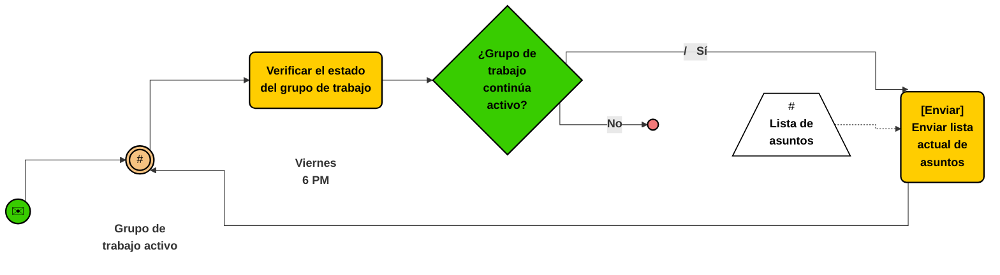

### Rafael Sánchez Saucedo
# Documento de Requerimientos - MRP (Trazabilidad, Caducidad y Merma)
**Módulo:** Gestión Avanzada de Órdenes de Compra (OC) y Órdenes de Producción (OP)

---

## 1. Definición de Requerimientos Funcionales

El módulo gestiona el ciclo operativo de aprovisionamiento y manufactura bajo esquemas de control por lotes, caducidad, merma técnica y costos indirectos de fabricación.

### Datos y Entidades Requeridas

* **Lote de Materia Prima / Componente:** ID Lote, ID Material, Cantidad Disponible, Cantidad Reservada, Fecha de Fabricación, Fecha de Caducidad, Ubicación en Almacén, Costo Unitario Real.
* **Lista de Materiales y Operaciones (BOM/Routing):** ID BOM, ID Producto Terminado, Componentes requeridos, Porcentaje de Scrap/Merma Nominal, Tiempo Estándar de Operación (minutos/horas máquina), Costo Indirecto Estimado.
* **Orden de Compra con Inspección (OC):** ID OC, ID Proveedor, Incoterm/Condición de Entrega, Líneas de Detalle (ID Material, Cantidad Solicitada, Cantidad Aceptada, Cantidad Rechazada, Precio Unitario, Lote Proveedor), Estado (`Emitida`, `En Aduana/Tránsito`, `Inspección de Calidad`, `Cerrada Conforme`, `Devuelta`).
* **Orden de Producción con Consumo Real (OP):** ID OP, ID Producto Terminado, Cantidad Programada, Cantidad Real Producida, Cantidad Desperdiciada (Scrap Real), Asignación de Lotes Consumidos (FIFO/FEFO), Centro de Trabajo, Estado (`Liberada`, `En Preparación`, `Paro de Línea`, `Finalizada con Desvío`, `Cerrada`).

---

## 2. Descripción de las Reglas de Negocio

* **Asignación de Materiales por FEFO (First Expired, First Out):** Al reservar componentes para una OP, el sistema debe asignar automáticamente aquellos lotes cuya fecha de caducidad sea más próxima, bloqueando lotes con vida útil menor al tiempo estimado de manufactura y distribución.
* **Ajuste por Merma Estándar:** Toda explosión de materiales para una OP debe calcular la materia prima bruta sumando el porcentaje de scrap inherente al proceso:
  $$\text{Cantidad Bruta} = \frac{\text{Cantidad Neta}}{1 - \% \text{Merma Nominal}}$$
* **Cuarentena e Inspección Previa al Stock Físico:** Las recepciones de OC no ingresan directamente a stock disponible; deben ingresar a un almacén lógico de `Inspección/Calidad`. Solo las partidas marcadas como "Aprobadas" se trasladan a inventario disponible; las unidades con defecto deben generar un folio de devolución o nota de crédito.
* **Tolerancia en Sobredelivery de Proveedores:** El sistema permite variaciones en la recepción física contra la OC de un máximo de $\pm 5\%$ en productos a granel/líquidos, recalculando la factura automáticamente sin permitir recepciones fuera de dicha tolerancia sin autorización gerencial.
* **Cierre de OP con Desvío:** Si la producción real difiere de la cantidad programada por variaciones de scrap, la OP solo puede cerrarse si el supervisor documenta la justificación del desvío cuando supere el umbral del $\pm 3\%$.

---

## 3. Integridad de los Datos

* **Trazabilidad Bidireccional Estricta:** Todo registro de producto terminado generado en una OP debe almacenar la relación matricial de los IDs de lote de materias primas exactos que se consumieron durante su corrida de producción (genealogía de lote).
* **Inmutabilidad de Lotes Cerrados:** Los registros de lotes asociados a una OP `Cerrada` o una OC `Cerrada Conforme` pasan a modo solo lectura; cualquier corrección posterior debe ejecutarse mediante movimientos de ajuste contable auditados.
* **Consistencia de Fechas Operativas:** La fecha de entrega prometida en una OC no puede ser anterior a la fecha de emisión; la fecha de caducidad asignada a un lote no puede ser anterior ni igual a su fecha de recepción/fabricación.
* **Balance de Masa en Producción:** En cada OP, la suma de la masa/cantidad del producto terminado obtenido más el scrap registrado debe cuadrar con la cantidad total de insumos consumidos dentro de la tolerancia de merma configurada.

---

## 4. Pruebas Unitarias

* `test_prioridad_fefo_lotes`: Validar que el algoritmo de reserva asigne primero el lote que caduca en 10 días antes que el lote que caduca en 30 días, independientemente de la fecha de recepción en almacén.
* `test_bloqueo_lote_vencido`: Verificar que la función `reservar_componente()` lance una excepción de tipo `ExpiredBatchException` si el lote seleccionado ha superado su fecha de caducidad.
* `test_calculo_merma_scrap`: Comprobar que para una necesidad de 100 unidades con una merma configurada del 10%, el sistema calcule una demanda de insumo de 111.11 unidades (o el redondeo superior establecido).
* `test_recepcion_excede_tolerancia`: Insertar una recepción física con un 10% por encima de lo solicitado en la OC y verificar que el método lance un error de validación de exceso de tolerancia.
* `test_cuarentena_aislada`: Asegurar que el método `obtener_stock_disponible_mrp(id_material)` no contabilice las existencias en almacén de `Inspección/Calidad`.

---

## 5. Pruebas Funcionales

* **Ciclo de Aprobación de Calidad y Devolución Parcial en OC:** Generar una OC de 1000 unidades. Registrar la llegada al área de inspección, aprobar 900 unidades y rechazar 100 por no conformidad. Verificar que el inventario disponible aumente únicamente en 900 unidades y que el estado de la OC se actualice a `Cerrada con Discrepancia`.
* **Trazabilidad de Retiro de Mercado (Recall):** Seleccionar un lote de materia prima defectuoso, ejecutar la consulta de genealogía inversa y validar que el sistema devuelva de inmediato todos los folios de OP donde se utilizó dicho lote, junto con los lotes de producto terminado resultantes y sus clientes asignados.
* **Paro de Línea por Insumo Degradado:** Iniciar una OP en estado `En Proceso`. Simular la invalidación de un lote de insumo en planta por daño físico; comprobar que el sistema bloquea el avance de la orden a `Completada`, emite la alerta al supervisor y permite la requisición de un lote sustituto sin reiniciar la orden desde cero.

